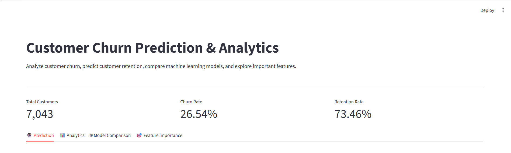
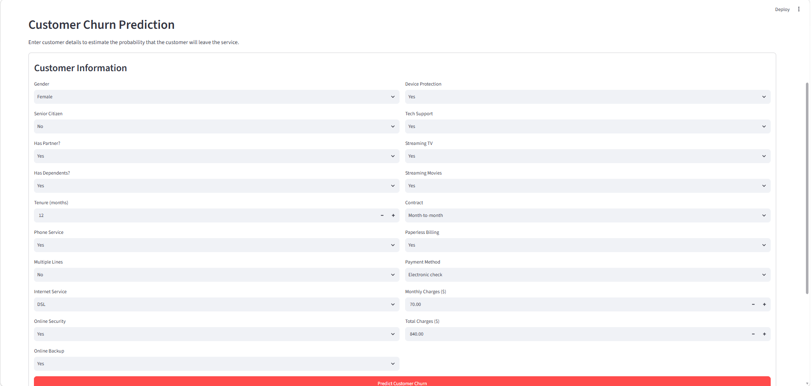
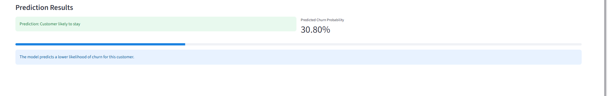
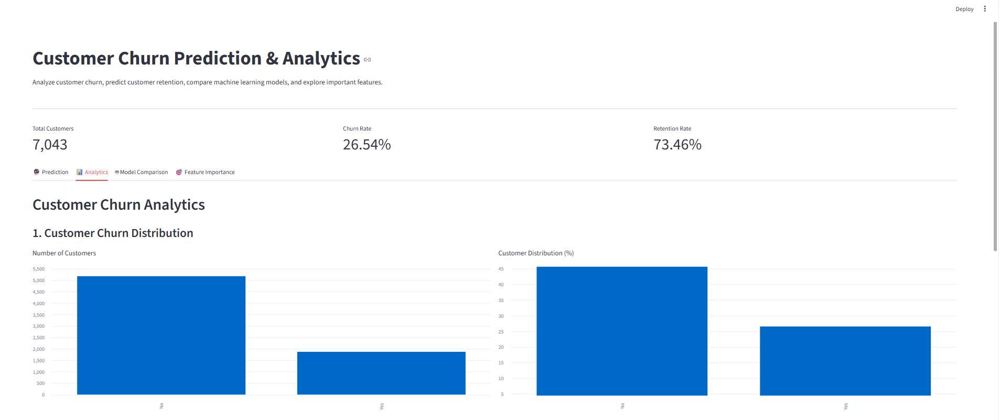
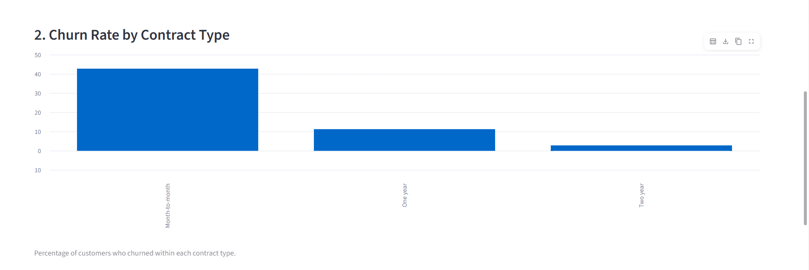
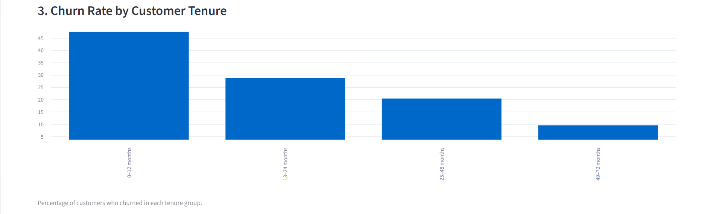
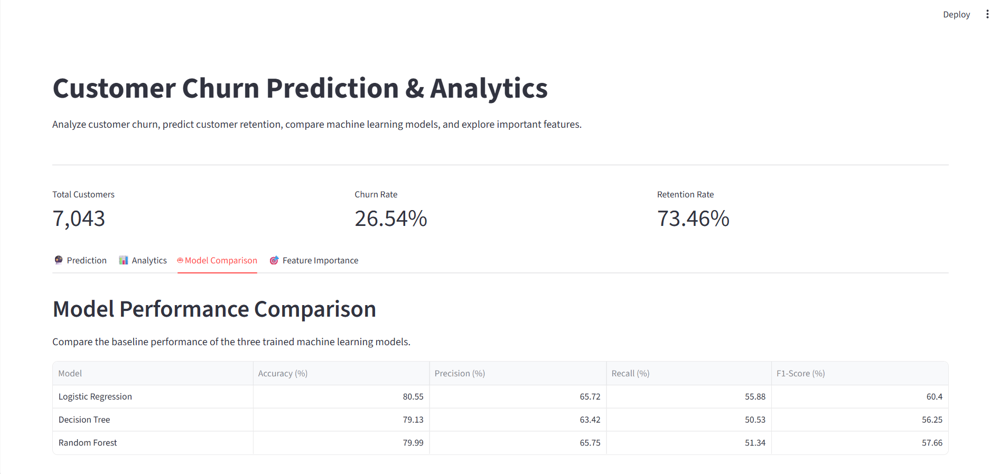
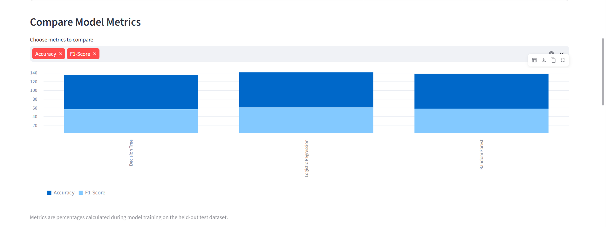
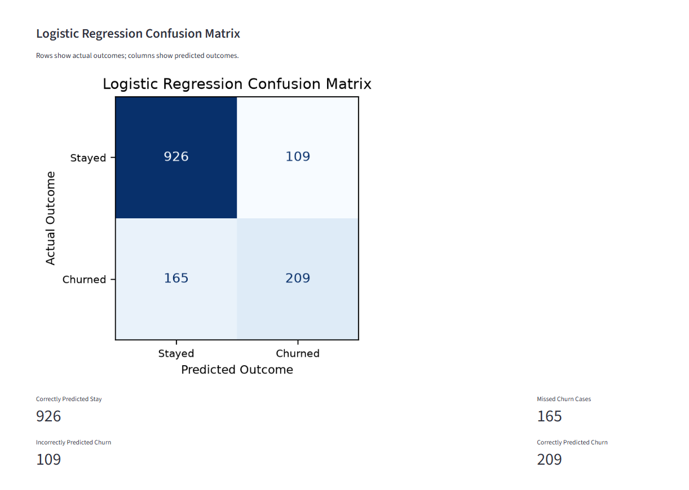

# Customer Churn Prediction & Analytics

A machine learning project that predicts customer churn and provides an interactive dashboard to explore customer behavior, compare models, and understand factors associated with churn.

## Project Overview

Customer churn occurs when customers stop using a company's services. This project uses the IBM Telco Customer Churn dataset to explore customer behavior, train classification models, and predict whether a customer is likely to leave.

## Features

- Customer churn prediction using a trained machine learning pipeline.
- Exploratory data analysis and churn analytics.
- Comparison of Logistic Regression, Decision Tree, and Random Forest.
- Model evaluation using accuracy, precision, recall, F1-score, and confusion matrices.
- Feature importance visualization.
- Interactive Streamlit dashboard.
- Automated tests using pytest.

## Technology Stack

- Python
- Pandas and NumPy
- Matplotlib
- Scikit-learn
- Streamlit
- Joblib
- Pytest
- Git and GitHub

## Project Structure

```text
customer-churn-prediction/
├── app/
│   └── streamlit_app.py
├── data/
│   ├── raw/
│   └── processed/
├── models/
│   └── logistic_regression_pipeline.joblib
├── notebooks/
│   └── 02_eda.ipynb
├── reports/
│   └── model_evaluation.json
├── src/
│   ├── data_exploration.py
│   ├── data_preprocessing.py
│   ├── feature_engineering.py
│   ├── train.py
│   └── predict.py
├── tests/
│   └── test_train.py
├── requirements.txt
├── .gitignore
└── README.md
```

## Model Results

The models were evaluated on a held-out test set.

| Model | Accuracy | Precision | Recall | F1-Score |
|---|---:|---:|---:|---:|
| Logistic Regression | 80.55% | 65.72% | 55.88% | 60.40% |
| Decision Tree | 79.13% | 63.42% | 50.53% | 56.25% |
| Random Forest | 79.99% | 65.75% | 51.34% | 57.66% |

Logistic Regression was selected as the saved prediction pipeline. It achieved the highest accuracy and F1-score among these three models on this test split.

## Installation and Setup

### 1. Clone the repository

```bash
git clone YOUR_GITHUB_REPOSITORY_URL
cd customer-churn-prediction
```

Replace `YOUR_GITHUB_REPOSITORY_URL` with your repository URL after publishing the project.

### 2. Create and activate a virtual environment

Windows PowerShell:

```powershell
python -m venv venv
.\venv\Scripts\Activate.ps1
```

### 3. Install dependencies

```bash
python -m pip install -r requirements.txt
```

### 4. Run the Streamlit dashboard

```bash
python -m streamlit run app/streamlit_app.py
```

The dashboard will open in your browser, usually at `http://localhost:8501`.

### 5. Retrain and evaluate the models

```bash
python src/train.py
```

### 6. Run automated tests

```bash
python -m pytest tests/ -v
```

## Dataset

This project uses the IBM Telco Customer Churn dataset, which contains customer account information, subscribed services, contract details, charges, and churn labels.

The dataset contains 7,043 customer records and 21 original columns.

## Testing

Automated tests cover:

- Removal of the customer identifier from model features.
- Encoding of churn labels.
- Numerical and categorical preprocessing.
- Predictions from the saved model pipeline.

Run the tests with:

```bash
python -m pytest tests/ -v
```

## Future Improvements

- Improve recall for customers likely to churn.
- Tune model hyperparameters and decision thresholds.
- Add model monitoring and explainability.
- Deploy the dashboard online.

## Disclaimer

Model predictions are estimates based on historical data. Associations in the dataset do not necessarily imply causation.


## Dashboard Screenshots

### 1. Customer Churn Prediction

#### Prediction Overview


#### Customer Information Form


#### Prediction Results


### 2. Customer Churn Analytics

#### Customer Churn Distribution


#### Churn Rate by Contract Type


#### Churn Rate by Customer Tenure


### 3. Model Performance Comparison

#### Model Performance Comparison


#### Compare Model Metrics


#### Logistic Regression Confusion Matrix



## 🚀 Live Demo

[**Open Customer Churn Prediction App**](https://c2qkbohezfs7yabmuy9qr3.streamlit.app/)
